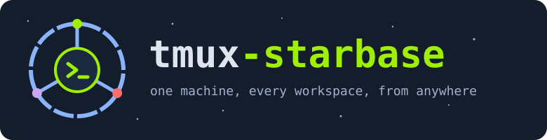
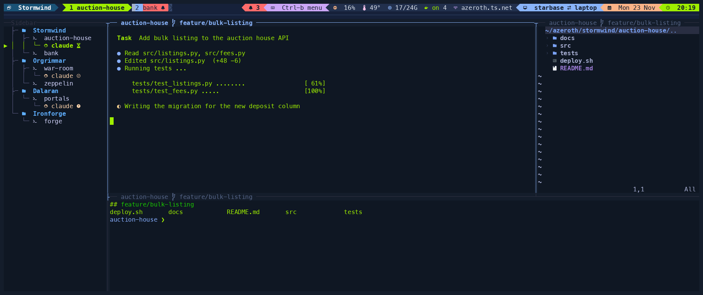
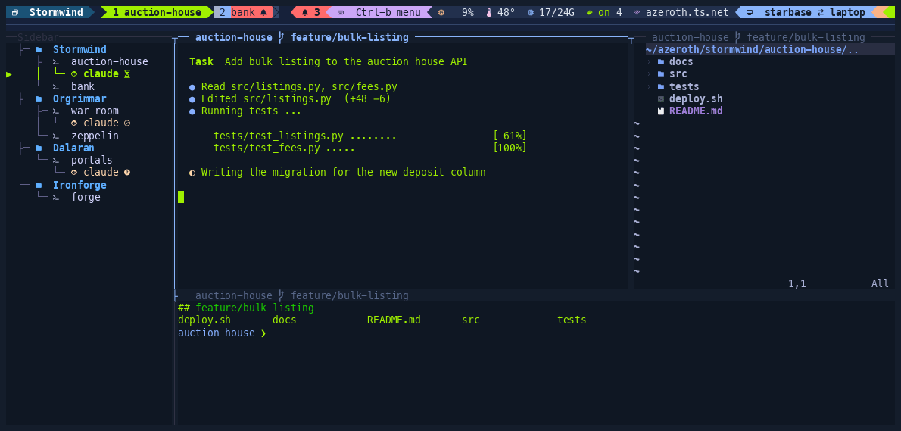
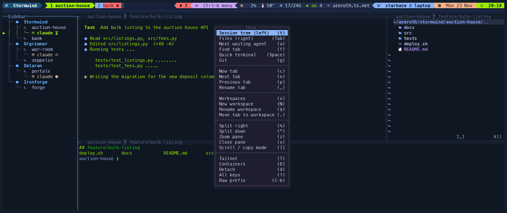
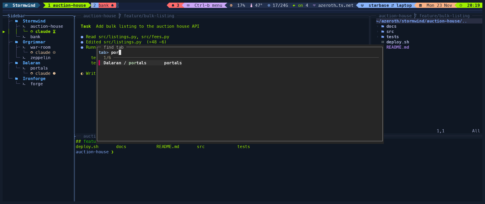
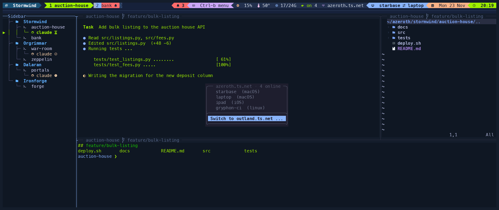
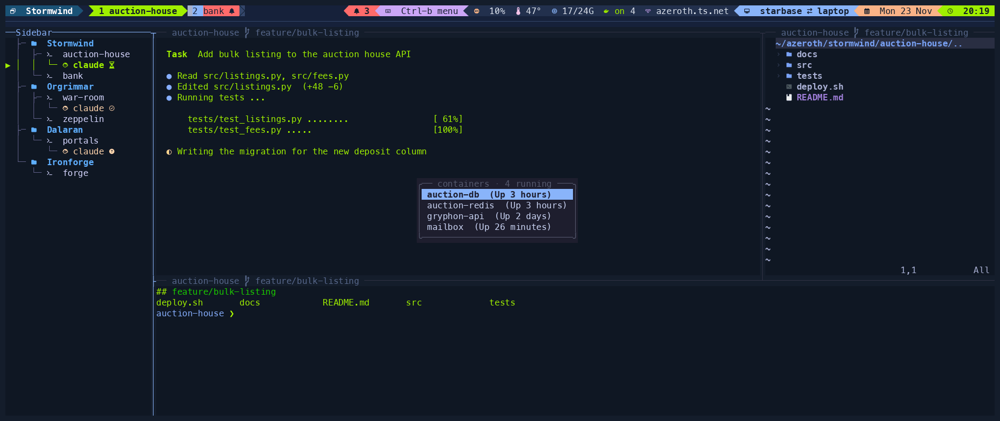
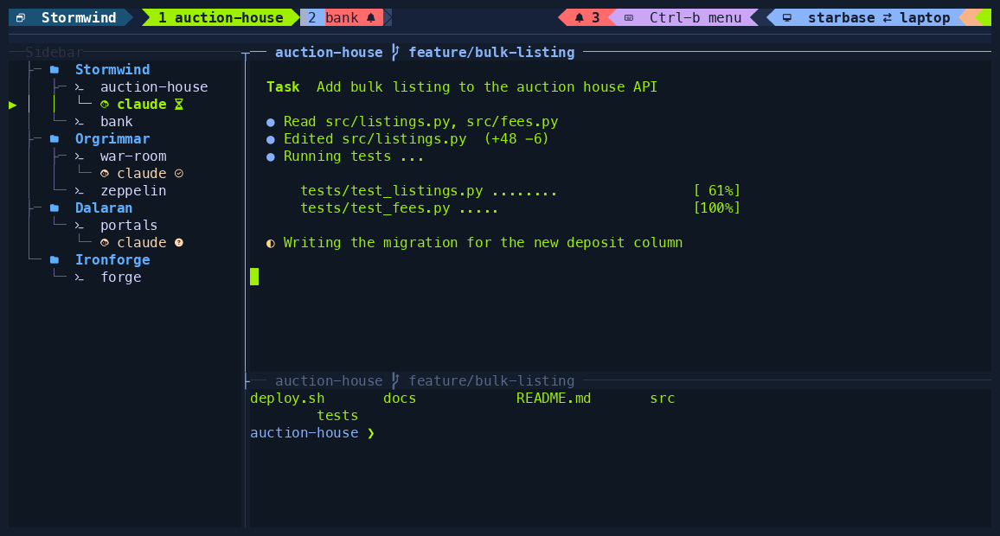

<p align="center"></p>

**tmux-starbase** turns one always-on Mac into a base you can dock to from anywhere. Your
workspaces, your tabs and the coding agents running in them live in tmux on that machine; any
plain terminal, local or over SSH, shows exactly the same thing, side panels included.



> The screenshots are a demo session with made-up projects and mock agent screens. The place
> names are a fan's nod to World of Warcraft, which belongs to Blizzard Entertainment.

## Why

I run several coding agents at once on a Mac that never sleeps, and I move around: desk, laptop,
tablet. I tried terminal apps with built-in sessions and side panels. They are pleasant locally,
but their panels belong to the app, so over SSH I either lost them or ended up with two
multiplexers stacked on top of each other, and attaching was hit or miss.

The fix was to put everything inside tmux:

- **The UI is made of tmux panes.** The session tree and the file tree are panes, the tab bar is
  the tmux status line. Whatever terminal you attach with, on whatever machine, you get the same
  screen.
- **The state lives on one machine.** Close the laptop, lose the connection, change device: the
  agents keep working. Reconnect and you are where you left off.
- **You can tell who needs you.** With ten agents open, the question is which one is waiting.
  Tabs turn red, a counter in the bar adds them up across workspaces, and one key takes you there.
- **Nothing to memorise.** `Ctrl-b` opens a menu with every action and its key.



## What you get

| | |
|---|---|
| **Workspaces and tabs** | One tmux session per workspace, one window per tab, each workspace with its own color in the bar. |
| **Session tree** (left) | Every workspace and tab, with a badge on the agents that are running, waiting or done. Click to jump. |
| **File tree** (right) | The directory of the current pane. Picking a file opens it in a simple editor in a pane above. |
| **Key menu** | `Ctrl-b` shows all actions. The usual tmux keys still work, so muscle memory is safe. |
| **Agent attention** | Red tab, a message in tmux and a desktop notification when a Claude Code session finishes or asks for permission. |
| **Find and jump** | Fuzzy finder over all tabs, `Option+1..9`, and "next waiting agent". |
| **Survives a reboot** | The layout is saved every 5 minutes and restored when tmux starts empty; each agent tab gets its `claude --resume <id>` typed, waiting for Enter. |
| **Status bar** | CPU, temperature, memory, Docker containers, tailnet, host, where you connect from, date and time. It folds on narrow terminals. |
| **Remote helpers** | A client command that cleans up after dropped links, SSH settings for instant reconnects, and `preview` to open an HTML file from the base on your laptop. |

<p>


</p>
<p>


</p>

## Requirements

- macOS with [Homebrew](https://brew.sh). Built and used on Apple Silicon with tmux 3.8.
  Linux is not supported yet; [docs/linux.md](docs/linux.md) lists what a port needs.
- A terminal with a [Nerd Font](https://www.nerdfonts.com) (the bar and the trees use its icons)
  and true color. I use [Ghostty](https://ghostty.org); any modern terminal should do.

The installer brings the rest: `tmux`, `bash` 5, `neovim` (it draws the file tree) and `fzf`,
plus three optional extras, `fresh-editor`, `lazygit` and `macmon`.

## Install

```bash
git clone https://github.com/HJulio/tmux-starbase ~/.tmux-starbase
~/.tmux-starbase/install.sh
starbase
```

The installer is safe to re-run. It:

- clones four tmux plugins into `~/.tmux-starbase/plugins`, pinned to tested commits;
- adds one line to `~/.tmux.conf` that loads `tmux/starbase.conf` (your file is backed up once
  as `~/.tmux.conf.pre-starbase`, and everything else in it keeps working);
- creates `~/.config/starbase/` with your workspaces file and a `local.conf` for your own settings;
- links the `starbase` and `preview` commands into Homebrew's `bin`;
- registers the Claude Code hooks in `~/.claude/settings.json`, if you use Claude Code.

Options: `--autostart` starts tmux with your workspaces at login, `--no-brew` skips package
installation, `--no-claude` skips the hooks.

**Update:** `git -C ~/.tmux-starbase pull && ~/.tmux-starbase/install.sh`.
**Uninstall:** `~/.tmux-starbase/uninstall.sh`.

## Daily use

Run `starbase`. It attaches to tmux; if tmux is empty it first restores your last layout, or
creates the starter layout from `~/.config/starbase/workspaces.sh` the very first time. It never
creates or restores anything over a running layout.

Press **`Ctrl-b`** for the menu:

| Key after Ctrl-b | Action |
|---|---|
| `t` / `Tab` | Session tree / file tree, on and off |
| `a` | Next waiting agent, in any workspace |
| `f` | Find tab: fuzzy search over every tab |
| `Space` | Quick terminal: a floating shell in the current directory |
| `g` | Git: lazygit for the current directory, floating |
| `c` `n` `p` `,` | New, next, previous, rename tab |
| `s` `N` `$` `.` | List, new, rename workspace; move the tab to another workspace |
| `%` `"` `z` `x` | Split right, split down, zoom, close pane |
| `[` | Scroll and copy mode |
| `T` / `D` | Tailnet menu / containers menu |
| `d` | Detach |
| `Ctrl-b` | The raw tmux prefix, for anything not in the menu |

Without the prefix: `Option+1..9` goes to tab N, `Option+Shift+←/→` to the previous or next tab.

With the mouse: click a tab or a row of the tree to go there; click the red counter, the
container count or the tailnet name for their menus; click anywhere else on the right of the bar
for the main menu; right-click a pane for tmux's pane menu.

## Your workspaces

`~/.config/starbase/workspaces.sh`:

```bash
ws Backend "#7D6608"                        # a workspace and its color in the bar
tab api    "$HOME/Code/api"    "claude"     # a tab: name, directory, optional command
tab worker "$HOME/Code/worker"

ws Frontend "#1A5276"
tab web "$HOME/Code/web" "claude"
```

Commands are typed into the tab, not run: you press Enter on the ones you want. The colors always
apply; the tabs are only the starter layout. From then on, what you had open is what comes back,
so a tab you closed stays closed and one you renamed keeps its name. New workspaces and tabs are
made from the menu (`N`, `c`).

## Working from another machine

On each machine you connect from, add the two snippets in [`client/`](client/): a `starbase`
shell function and an SSH host entry.

```bash
starbase        # = ssh -t <your-base> starbase, plus cleanup when the link drops
```

- **Same screen everywhere.** The bar shows where each terminal connects from, so you can tell
  the local view from a remote one.
- **Different screen sizes.** tmux fits each tab to the terminal that used it last. The side
  panels keep their width and the bar folds its date, clock and stats down to colored arrows when
  the terminal is narrow.
- **Dropped connection.** Nothing is lost; run `starbase` again. The SSH settings notice a dead
  link within a minute and reuse one authenticated connection, so reconnecting is instant.
- **Reaching the base.** Any way of getting SSH to it works. With
  [Tailscale](https://tailscale.com) the bar shows the current tailnet and a menu lists the
  machines online; if the base has several Tailscale accounts, the menu switches between them
  (it asks first: a terminal coming from another tailnet disconnects).
- **Looking at an HTML file.** `preview report.html` on the base serves the folder on localhost
  and prints the one line to run on your laptop: an SSH tunnel plus `open`.



## Agents

The session tree recognises Claude Code, Codex, opencode, Cursor and others (that comes from
[tmux-pane-tree](https://github.com/sandudorogan/tmux-pane-tree)). The extras below are wired for
**Claude Code**, through its hooks:

- **Attention.** When a session finishes a turn or asks for permission in a tab you are not
  looking at: the tab turns red with a bell, tmux shows which workspace and tab, the counter in
  the bar goes up, and the terminal gets a desktop notification (terminals usually show it only
  while their window is not focused, and macOS must allow them to notify).
- **Conversation ids.** Each tab remembers the conversation it holds, so a restore types the
  exact `claude --resume <id>`.

Hooks are read when a session starts, so sessions opened before installing do not have them until
you restart them.

## Surviving a reboot

tmux keeps running when terminals close or connections drop; only a reboot of the base ends it.
The layout (workspaces, tabs and names, splits, directories) is saved every 5 minutes into
`~/.local/state/starbase/snapshots`. When `starbase` finds tmux empty it rebuilds that layout.
With `install.sh --autostart` this happens at login, before you open a terminal.

- Agents are not started: their command is typed into the tab and waits for Enter.
- The side panels come back closed; reopen them from the menu.
- Up to 5 minutes of layout changes can be lost, and saving needs a terminal attached.
- Older snapshots stay in that folder; point the `last` symlink at one to restore it.

## Optional pieces

All of these are detected at run time. Without them, their part of the bar or menu is just absent.

| Tool | What it adds |
|---|---|
| `macmon` | CPU load, CPU temperature and memory in the bar (Apple Silicon) |
| Docker (`docker` on the PATH, or OrbStack) | `on`/`off` and the number of running containers; a menu that lists them and shows their logs |
| Tailscale (the `tailscale` CLI, or the macOS app) | The tailnet in the bar, the tailnet menu, and machine names instead of addresses |
| `lazygit` | The floating git window |
| `fresh-editor` | The editor for files picked in the tree. Otherwise `$EDITOR`, then `nano`; set `STARBASE_EDITOR` to choose |
| Claude Code | Notifications and conversation ids |

## Making it yours

Put your settings in `~/.config/starbase/local.conf`. It is plain tmux configuration, loaded last,
and never touched by updates. The file comes with commented examples: order of the workspaces in
the tree, width of the panels, bar at the bottom, no dimming of inactive panes.

Colors, the bar's segments and the menu are in [`tmux/starbase.conf`](tmux/starbase.conf), which
is commented throughout.

For a status line with the base's state when you open a shell, add this to `~/.zshrc` on the
base: `[[ -o interactive && -z $TMUX ]] && ~/.tmux-starbase/bin/motd.sh`.

## What is inside

| Path | Purpose |
|---|---|
| `tmux/starbase.conf` | Options, status bar, theme, plugins, the `Ctrl-b` menu, key and mouse bindings |
| `bin/starbase` | Brings up or restores the workspaces and attaches |
| `bin/sysstat.sh`, `bin/client-where.sh`, `bin/git-branch.sh` | Status bar and pane title segments |
| `bin/tree-toggle.sh`, `bin/fix-widths.sh` | Session tree in every tab at once; side panels kept at their width |
| `bin/find-tab.sh`, `bin/next-waiting.sh` | Fuzzy tab finder; jump to a waiting agent |
| `bin/tailnet-menu.sh`, `bin/docker-menu.sh` | The two menus |
| `bin/preview`, `bin/motd.sh` | HTML preview over a tunnel; login banner |
| `bin/save-claude-sessions.sh`, `claude/` | Claude Code hooks and their installer |
| `nvim/init.lua` | Look and editor of the file tree |
| `patches/` | A small patch applied to tmux-pane-tree at install |
| `examples/`, `client/` | Starter config, and the snippets for the machines you connect from |

It stands on four plugins, cloned at pinned commits and without a plugin manager:

- [tmux-pane-tree](https://github.com/sandudorogan/tmux-pane-tree): the session tree and agent badges.
  It gets a small local patch (icons on workspaces and tabs, muted tree lines, bold workspace
  names); most of it is proposed upstream.
- [treemux](https://github.com/kiyoon/treemux): the file tree.
- [tmux-resurrect](https://github.com/tmux-plugins/tmux-resurrect) and
  [tmux-continuum](https://github.com/tmux-plugins/tmux-continuum): layout snapshots.

[docs/maintaining.md](docs/maintaining.md) explains how to change the setup safely and how the
plugins are updated.

## Status

This is my daily setup, shared as is. It is tested on one kind of machine (macOS on Apple
Silicon). Issues and pull requests are welcome, a Linux port especially.

## License

[MIT](LICENSE). The plugins keep their own licenses.
